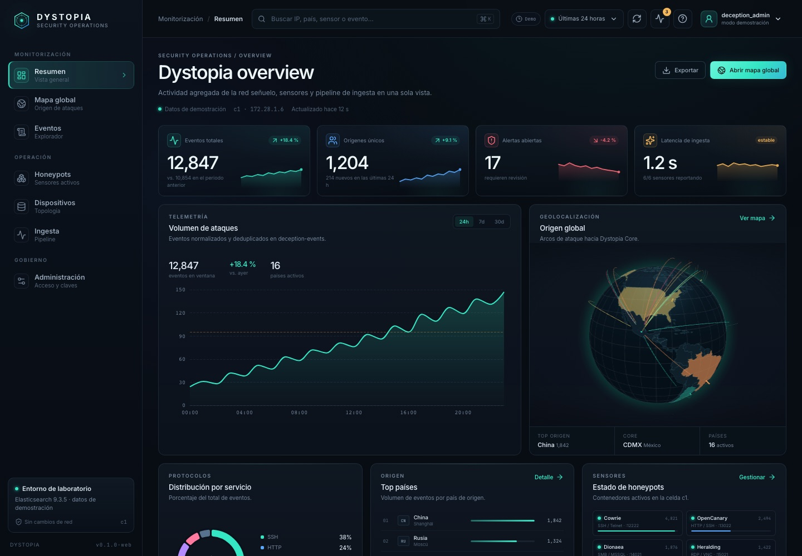
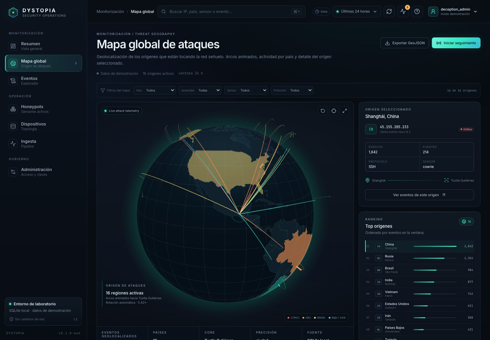
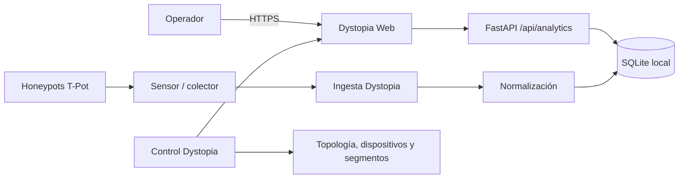

# Dystopia

Plataforma de deception y honeypots basada en Python/FastAPI, con un plano de
control propio, una interfaz web propia (**Dystopia Web**) y almacenamiento
local en SQLite. Está siendo endurecida para **Ubuntu Server 24.04 LTS con
KVM/libvirt**.

Dystopia toma como referencia el ecosistema **T-Pot - The All In One Multi
Honeypot Platform**, pero no es un clon: mantiene su propio contrato de eventos,
topología, modelo de permisos y almacén local. **El stack Elasticsearch/Kibana
ya no forma parte del proyecto**; se conservan únicamente los honeypots del MVP
y la analítica local.





## Estado

- Dystopia Web operativa con resumen, globo 3D, explorador de eventos,
  honeypots, dispositivos, ingesta y administración.
- Analítica local sobre SQLite (`deception_events` o `events`); sin
  Elasticsearch ni Kibana.
- Honeypots del MVP: Cowrie, OpenCanary, Dionaea, Heralding, RedisHoneyPot y
  Endlessh.
- Suite completa, `ruff` y `pyright` en verde.
- **La activación real de celdas KVM/nftables/systemd sigue pendiente de
  validación.** No es un despliegue de producción certificado.
- No hay contraseñas por defecto ni bootstrap público.

## Qué usa Dystopia

| Área | Componentes |
|---|---|
| Control | Python 3.12+, FastAPI, Uvicorn, Pydantic, slowapi, JWT, bcrypt, PyYAML |
| Interfaz | React 19, TypeScript, Vite, ECharts, react-globe.gl |
| Estado | SQLite local, ficheros de configuración y socket Unix de consulta |
| Analítica | BFF `/api/analytics/*` sobre SQLite y GeoIP local |
| Contenedores | Docker y Docker Compose |
| Honeypots MVP | Cowrie, OpenCanary, Dionaea, Heralding, RedisHoneyPot, Endlessh |
| Red y host | KVM/libvirt, systemd, nftables, VLANs/segmentos |
| Calidad | pytest, ruff, pyright informativo, GitHub Actions |

Las dependencias y su procedencia están en
[`requirements.txt`](requirements.txt),
[`deploy/requirements-control.in`](deploy/requirements-control.in) y
[`docs/DEPENDENCY-PROVENANCE.md`](docs/DEPENDENCY-PROVENANCE.md).

## Relación con T-Pot

T-Pot ofrece 20+ honeypots y un conjunto amplio de herramientas. Dystopia adopta
el modelo de contenedores y los honeypots del MVP, pero sustituye ELK por su
propio almacén local y su propia interfaz.

| Herramienta T-Pot | Estado en Dystopia |
|---|---|
| Docker / Compose | Adoptado |
| Honeypots (Cowrie, OpenCanary, Dionaea, Heralding, RedisHoneyPot, Endlessh) | Adoptado |
| Elastic Stack / Kibana | **Retirado** |
| Logstash | No usado |
| Attack Map | Sustituido por el globo 3D de Dystopia Web |
| CyberChef, Elasticvue, Spiderfoot | No incluido |
| Suricata, Fatt, P0f | No incluido |
| Autoheal | No incluido |
| EWSposter | No incluido |
| Ollama / ChatGPT / honeypots LLM | Fuera de alcance |

La tabla completa de honeypots y herramientas está en
[`docs/TPOT-COMPATIBILITY.md`](docs/TPOT-COMPATIBILITY.md).

## Arquitectura



Planos:

- **Control:** API, topología, usuarios, consola y contratos.
- **Sensor:** recogida de logs y transporte autenticado.
- **Ingesta/proceso:** recepción, normalización, deduplicación y persistencia.
- **Analítica:** Dystopia Web y BFF sobre SQLite; no sustituye la topología.

### Fichas de origen y configuración de honeypots

En **Honeypots**, cada IP observada abre una ficha con los eventos, acciones,
protocolos, sensores, dispositivos y detalles capturados disponibles durante los
últimos 90 días. También se puede consultar una IP específica aunque no aparezca
en la muestra inicial de 100 eventos. La consulta está acotada por
`DYSTOPIA_ANALYTICS_MAX_ROWS` (20 000 por defecto, por IP); no se debe interpretar
como un historial sin límite. Una IP observada no prueba la identidad humana de
un atacante. Las notas, etiquetas, alias y clasificación son anotaciones
separadas: **nunca modifican los eventos originales**.

La ficha permite descargar la evidencia normalizada en CSV o JSON con
`GET /api/investigations/attackers/{ip}/export?format=csv|json&limit=5000`.
Requiere una sesión humana con rol `viewer` o superior (no API keys); el límite
válido es de 1 a 10 000 y la exportación nunca excede
`DYSTOPIA_ANALYTICS_MAX_ROWS`. Usa la misma ventana de 90 días y muestra acotada
por IP que la ficha: `total` cuenta solo las filas consultadas, `exported` las
incluidas y `truncated` indica si el límite de exportación dejó filas fuera de
esa muestra. **No es un historial exhaustivo.** No exporta notas, alias,
etiquetas ni clasificación del analista: son anotaciones privadas separadas.
La descarga no escribe en el almacén original ni crea `investigations.db`.
La ficha pagina la evidencia de `deception_events` por `(src_ip, ts DESC, id DESC)`
con `offset` (0–10 000) y `limit` (1–100); los empates de tiempo se
ordenan por ID. `summary=false` en páginas adicionales omite los agregados
(que la interfaz reutiliza de la primera página) y evita volver a leer toda
la muestra. El GET predeterminado mantiene la respuesta completa. `total`
sigue limitado a las 20 000 filas recientes por IP
(o al valor configurado), no representa un histórico exhaustivo. Si llegan
nuevos eventos entre peticiones, el desplazamiento puede cambiar; no es una
instantánea transaccional entre páginas.

El **timeline** de analítica agrega eventos dentro de la ventana seleccionada
(hasta 90 días) con un máximo de `DYSTOPIA_ANALYTICS_MAX_ROWS` filas por
consulta. La **búsqueda global** de la barra superior filtra los datos ya
cargados en cada vista; en vivo, los eventos precargados son como máximo 100.
Para buscar en la muestra acotada del almacén, la API
`GET /api/analytics/events?q=texto&limit=25&offset=0` filtra hasta el mismo
máximo de filas (no busca en todo el histórico). Para investigar una IP fuera
de la muestra global, ábrela directamente desde Honeypots: su autocompletado
usa `GET /api/investigations/attackers?query=203.0.113.&limit=20`, una
búsqueda por prefijo de IP acotada por el mismo límite de filas.

Un usuario autenticado con rol `viewer` puede consultar las fichas y los borradores;
`operator` o `admin` pueden guardar anotaciones y solo `admin` puede guardar
borradores de sensores. Se usa control optimista de revisiones (HTTP 409 si otro
operador guardó antes). Los borradores editables incluyen nombre visible,
descripción, memoria, CPU y límite de procesos; el inventario estático y el
runtime permanecen intactos. La ruta de aplicación devuelve HTTP 409 de forma
intencional: **no existe todavía verificador independiente del aislamiento ni
un ciclo de vida autorizado para aplicar cambios a contenedores**.

Las anotaciones y borradores se guardan en `investigations.db` dentro de
`DYSTOPIA_CONTROL_STATE`. Ese directorio debe estar provisionado previamente,
con propiedad del servicio y permisos privados (0700); el servicio no crea el
directorio por sí mismo. Los GET no crean bases de datos. Para usar la pantalla
con evidencia real, se necesita iniciar sesión y tener el colector conectado al
almacén SQLite; sin sesión la pantalla indica explícitamente que es una demo.

### Trazabilidad y plan de cambios

Cada guardado de anotaciones o borradores añade, en la misma transacción, una
fila a `audit` en `investigations.db` con actor, revisión, estado anterior y
nuevo. `AUDIT_MAX_ROWS` conserva por defecto las **10 000 filas más recientes**
de auditoría y poda solo las más antiguas al guardar. La retención es por
**número de filas, no por tiempo**; nunca poda `profiles`, `sensor_drafts` ni
los eventos capturados. El almacén privado tiene un presupuesto de **64 MiB**
para que la auditoría acotada por filas no agote el archivo antes de podar.
`GET /api/investigations/attackers/{ip}/history` y
`GET /api/investigations/honeypots/{sensor}/history` devuelven el historial
(diferencias por campo y quién las hizo), visible para `viewer`. El historial no
se puede editar ni borrar desde la API.

`GET /api/investigations/honeypots/{sensor}/plan` compara el borrador con el
inventario estático `deploy/honeypots/inventory.yaml` y devuelve el diff por
campo, un `plan_sha256` determinista y los motivos de bloqueo. El plan es
descriptivo: **no autoriza ni ejecuta nada**. `POST .../apply` sigue respondiendo
`409` e incluye el prefijo del hash del plan para que el operador sepa qué
borrador intentó aplicarse.

## Requisitos

| Tipo | RAM | Disco | Notas |
|---|---|---|---|
| Laboratorio completo | 8 GB | 64–128 GB SSD | Honeypots + SQLite + interfaz |
| Sensor/celda | 4–8 GB | 64 GB SSD | Depende del volumen de ataque |
| Evaluación del panel | 4 GB | 20–40 GB libres | Datos sintéticos o pocos eventos |

Además:

- IPv4 por DHCP o estática.
- Salida a Internet para descargar imágenes y actualizaciones.
- DNS y NTP operativos.
- Sistema base mínimo, sin escritorio gráfico.
- SSH para administración.

## Puertos

| Puerto | Protocolo | Dirección | Uso |
|---|---|---|---|
| 8082 | TCP | entrada local/gestión | API de control y Dystopia Web |
| 22 | TCP | entrada gestión | SSH del sistema |
| Unix socket | local | consulta | Puente de consulta, sin TCP |

Los puertos de honeypots dependen de la celda y del perfil desplegado. Están
documentados en [`deploy/honeypots/inventory.yaml`](deploy/honeypots/inventory.yaml).

T-Pot usa `64294`, `64295` y `64297` para su propia gestión. **Dystopia no usa
esos puertos**; no los abras por analogía.

## Instalación y evaluación

### Desarrollo local de la interfaz

```bash
cd web
npm install
npm run dev
```

Vite sirve la UI en `http://127.0.0.1:5173` y redirige `/api` al control plane
en `http://127.0.0.1:8082`.

### Control plane

```bash
python3 -m runtime.install --dry-run --config deploy/install.example.json
```

Después, seguir [`docs/HARDENING-OPERATIONS.md`](docs/HARDENING-OPERATIONS.md)
con autorización, bundle offline, lock/hash y recuperación disponibles. No abrir
la red señuelo hasta completar la verificación.

## Primer arranque

1. Provisionar secretos y usuarios locales.
2. Instalar y validar systemd, permisos y directorios.
3. Arrancar control e ingesta.
4. Configurar el almacén SQLite (`DYSTOPIA_ANALYTICS_DB`) si se usa una ruta
   distinta de la base de control por defecto.
5. Arrancar los honeypots del MVP.
6. Verificar que la ingesta escribe en SQLite.
7. Abrir Dystopia Web en `http://127.0.0.1:8082/`.
8. Solo después, habilitar tráfico autorizado.

## Uso

- **Operador:** Dystopia Web (resumen, mapa, eventos, honeypots y topología).
- **Ingesta:** sensores y honeypots envían eventos al pipeline; `event.id`
  evita duplicados.
- **Analista:** consulta eventos y mapa sin escritura.
- **Administrador:** gestiona topología, usuarios y claves.
- **Consulta:** el control usa el puente Unix o el BFF SQLite, nunca una base
  de sensor expuesta a la red.

## Usuarios y permisos

| Identidad | Uso |
|---|---|
| Usuario administrador local | Administración diaria de Dystopia |
| Usuario analyst/viewer | Lectura de eventos y mapa |
| Usuario de sensor | Authentication de ingesta, por dispositivo |
| Usuario del sistema | Servicios systemd; sin privilegios de aplicación |

No se comparten contraseñas, API keys ni secretos entre entornos.

## Mantenimiento

- Retención de eventos en SQLite.
- Backup/restore: pendiente de probar en Linux.
- Actualizaciones de imágenes y sistema: pendiente de runbook certificado.
- Revisión de logs y salud de contenedores.
- Revisión de secretos y dependencias antes de cada release.

## Límites actuales

- KVM/libvirt, nftables, systemd, red de segmentos y honeypots reales no están
  certificados todavía.
- No se integran los 20+ honeypots de T-Pot.
- No hay envío comunitario de datos.
- TLS/reverse proxy de producción pendiente.
- Snapshots/restore y observabilidad de producción pendientes.
- La ingesta real de logs de T-Pot a SQLite requiere completar el colector en
  la celda Linux.

## Documentación

- [Referencia técnica](docs/REFERENCE.md)
- [Handoff al servidor Linux](docs/LINUX-HANDOFF.md)
- [Validación de builds de honeypots](docs/HONEYPOT-BUILDS.md)
- [Orquestador de honeypots por celda](docs/HONEYPOT-ORCHESTRATION.md)
- [Plano de datos runtime](docs/RUNTIME-DATAPLANE.md)
- [Auditoría de seguridad del runtime](docs/RUNTIME-SECURITY-AUDIT.md)
- [Bundle offline y locks](docs/OFFLINE-BUNDLE.md)
- [SBOM](docs/SBOM.md)
- [TLS y reverse proxy](deploy/tls-proxy/README.md)
- [Compatibilidad con T-Pot](docs/TPOT-COMPATIBILITY.md)
- [Arquitectura y diagnóstico](docs/HARDENING.md)
- [Instalación, operación y recuperación](docs/HARDENING-OPERATIONS.md)
- [Pruebas y pendientes](docs/HARDENING-TESTS.md)
- [Roadmap](docs/ROADMAP.md)
- [Consola operativa](docs/CONSOLE-OPERATIONS.md)
- [Integración operativa offline](docs/OPS-INTEGRATION.md)
- [Puente de consulta Unix](docs/QUERY-BRIDGE.md)
- [Migración](MIGRATION.md)
- [Procedencia de dependencias](docs/DEPENDENCY-PROVENANCE.md)
- [Licencia](LICENSE)
- [Licencias de terceros](LICENSE-THIRD-PARTY.md)

## Atribución

Dystopia reutiliza conceptos y algunos honeypots del ecosistema T-Pot, pero
mantiene su propio contrato, almacén y modelo de control. Las licencias de cada
componente pertenecen a sus proyectos originales; consulte sus repositorios y
la documentación de cada proyecto.

## Licencia

Dystopia se distribuye bajo la **Licencia MIT**. Consulta [`LICENSE`](LICENSE)
para el texto completo.

Los componentes de terceros que Dystopia compila, descarga o ejecuta conservan
sus propias licencias (BSD, GPL, Unlicense, etc.). El detalle está en
[`LICENSE-THIRD-PARTY.md`](LICENSE-THIRD-PARTY.md) y en
[`deploy/honeypots/PROVENANCE.md`](deploy/honeypots/PROVENANCE.md).

```text
SPDX-License-Identifier: MIT
```

No ejecutes instalación, servicios o laboratorio sin autorización y
prerrequisitos. `.env` no se carga automáticamente.
