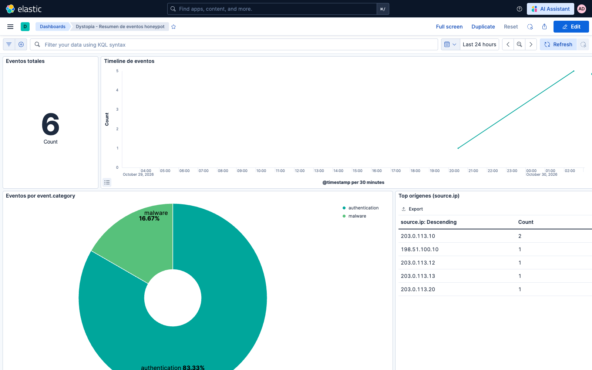
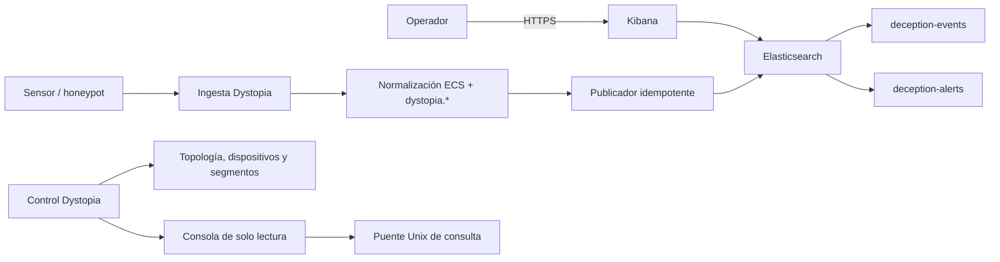

# Dystopia

Plataforma de deception y honeypots basada en Python/FastAPI, con un plano de
control propio y Elasticsearch/Kibana como panel analítico. Está siendo
endurecida para **Ubuntu Server 24.04 LTS con KVM/libvirt**.

Dystopia toma como referencia el ecosistema **T-Pot - The All In One Multi
Honeypot Platform**, pero no es un clon: mantiene su propio contrato de eventos,
publicador, topología y modelo de permisos.



## Estado

- Integración de ingesta, contrato ECS/Dystopia y dashboards validada en
  laboratorio con Elasticsearch/Kibana 9.3.5.
- Suite completa, ruff y CI de GitHub Actions en verde.
- **La instalación en servidor Linux y la contención real siguen pendientes de
  validación.** No es un despliegue de producción certificado.
- No hay contraseñas por defecto ni bootstrap público.

## Índice

- [Soporte y entornos](#soporte-y-entornos)
- [Qué usa Dystopia](#qué-usa-dystopia)
- [Relación con T-Pot](#relación-con-t-pot)
- [Arquitectura](#arquitectura)
- [Requisitos](#requisitos)
- [Puertos](#puertos)
- [Instalación y evaluación](#instalación-y-evaluación)
- [Primer arranque](#primer-arranque)
- [Uso](#uso)
- [Usuarios y permisos](#usuarios-y-permisos)
- [Mantenimiento](#mantenimiento)
- [Límites actuales](#límites-actuales)
- [Documentación](#documentación)
- [Atribución](#atribución)

## Soporte y entornos

| Entorno | Soporte | Uso |
|---|---|---|
| Ubuntu Server 24.04 LTS + KVM/libvirt | Objetivo de producción | Control, sensores, honeypots y analítica |
| Ubuntu Server 24.04 sin KVM | Limitado | Control y analítica; no valida celdas reales |
| macOS con Docker Desktop/Colima | Evaluación | Panel, contratos, tests y eventos sintéticos |
| Windows con Docker Desktop | No validado | No se certifica |
| ARM64 | No validado | No se afirma compatibilidad de imágenes |

T-Pot documenta macOS y Windows con Docker Desktop para pruebas limitadas.
Dystopia solo ha probado el plano analítico en macOS/Colima. Para producción se
requiere Linux.

## Qué usa Dystopia

| Área | Componentes |
|---|---|
| Control | Python 3.12+, FastAPI, Uvicorn, Pydantic, slowapi, JWT, bcrypt, PyYAML |
| Estado | SQLite, ficheros de configuración y socket Unix de consulta |
| Analítica | Elasticsearch 9.3.5, Kibana 9.3.5 |
| Contenedores | Docker y Docker Compose |
| Honeypots MVP | Cowrie, OpenCanary, Dionaea, Heralding, RedisHoneyPot, Endlessh |
| Red y host | KVM/libvirt, systemd, nftables, VLANs/segmentos |
| Calidad | pytest, ruff, pyright informativo, GitHub Actions |

Las dependencias y su procedencia están en
[`requirements.txt`](requirements.txt),
[`deploy/requirements-control.in`](deploy/requirements-control.in) y
[`docs/DEPENDENCY-PROVENANCE.md`](docs/DEPENDENCY-PROVENANCE.md).

## Relación con T-Pot

T-Pot ofrece 20+ honeypots y un conjunto amplio de herramientas. Dystopia adopta
el modelo de contenedores y Elastic Stack, pero integra un subconjunto para el
MVP.

| Herramienta T-Pot | Estado en Dystopia |
|---|---|
| Docker / Compose | Adoptado |
| Elastic Stack | Adoptado con ES/Kibana 9.3.5 |
| Logstash | Sustituido por publicador propio |
| NGINX | Pendiente para TLS/proxy de producción |
| Kibana | Adoptado con 7 dashboards propios |
| Attack Map | No incluido; mapa estático en Kibana |
| CyberChef, Elasticvue, Spiderfoot | No incluido |
| Suricata, Fatt, P0f | No incluido |
| Autoheal | No incluido |
| EWSposter | No incluido; publicación explícita |
| Ollama / ChatGPT / honeypots LLM | Fuera de alcance |

La tabla completa de honeypots y herramientas, con su estado, está en
[`docs/TPOT-COMPATIBILITY.md`](docs/TPOT-COMPATIBILITY.md).

## Arquitectura



Planos:

- **Control:** API, topología, usuarios, consola y contratos.
- **Sensor:** recogida de logs y transporte autenticado.
- **Ingesta/proceso:** recepción, normalización, deduplicación y alertas.
- **Analítica:** Elasticsearch/Kibana; no sustituye la topología de Dystopia.

## Requisitos

Referencia conservadora, alineada con T-Pot Hive/Sensor. Ajustar según retención
y volumen:

| Tipo | RAM | Disco | Notas |
|---|---|---|---|
| Laboratorio completo | 16 GB | 128–256 GB SSD | Elastic Stack + honeypots + datos |
| Sensor/celda | 8 GB | 128 GB SSD | Depende del volumen de ataque |
| Evaluación del panel | 8 GB | 40–50 GB libres | Solo analítica y datos sintéticos |

Además:

- IPv4 por DHCP o estática.
- Salida a Internet para descargar imágenes y actualizaciones.
- DNS y NTP operativos.
- Sistema base mínimo, sin escritorio gráfico.
- SSH para administración.

## Puertos

| Puerto | Protocolo | Dirección | Uso |
|---|---|---|---|
| 8082 | TCP | entrada local/gestión | API de control |
| 5601 | TCP | entrada local/gestión | Kibana; debe ir tras proxy/TLS en producción |
| 9200 | TCP | entrada local/gestión | Elasticsearch; nunca público |
| 22 | TCP | entrada gestión | SSH del sistema |
| Unix socket | local | consulta | Puente de consulta, sin TCP |

Los puertos de honeypots dependen de la celda y del perfil desplegado. Están
documentados en [`deploy/honeypots/inventory.yaml`](deploy/honeypots/inventory.yaml).

T-Pot usa `64294`, `64295` y `64297` para su propia gestión. **Dystopia no usa
esos puertos**; no los abras por analogía.

## Instalación y evaluación

### Evaluación sin servidor Linux

Para conocer el panel, contratos y dashboards se puede usar Docker Desktop o
Colima. Es un entorno de evaluación, no producción:
[`docs/EVALUATION-LAB.md`](docs/EVALUATION-LAB.md).

### Instalación en Ubuntu

Todavía **no hay un instalador one-liner certificado**. El procedimiento
soportado es:

```bash
python3 -m runtime.install --dry-run --config deploy/install.example.json
```

Después, seguir [`docs/HARDENING-OPERATIONS.md`](docs/HARDENING-OPERATIONS.md)
con autorización, bundle offline, lock/hash y recuperación disponibles. No abrir
la red señuelo hasta completar la verificación.

## Primer arranque

1. Provisionar secretos y usuarios locales.
2. Instalar y validar systemd, permisos y directorios.
3. Arrancar control, ingesta y proceso.
4. Configurar Elasticsearch/Kibana.
5. Ejecutar el bootstrap de roles, usuarios, ILM y data streams.
6. Importar el bundle de Kibana con `overwrite=true`.
7. Enviar un evento sintético y comprobar Discover.
8. Solo después, habilitar la celda y el tráfico autorizado.

## Uso

- **Operador:** dashboards de Kibana, Discover y consola de solo lectura.
- **Ingesta:** sensores y honeypots envían eventos al publicador; `event.id`
  evita duplicados.
- **Analista:** consulta data streams y dashboards sin escritura.
- **Administrador:** gestiona topología y el espacio `deception-*`; `elastic`
  queda para bootstrap y emergencias.
- **Consulta:** el control usa el puente Unix, no la base SQLite del sensor.

Guía de evaluación con capturas:
[`docs/EVALUATION-LAB.md`](docs/EVALUATION-LAB.md).

## Usuarios y permisos

| Identidad | Uso |
|---|---|
| `deception-admin` | Administración diaria del panel y topología |
| `deception-analyst` | Lectura de dashboards y data streams |
| `deception-ingest-writer` | API key del publicador; sin acceso a Kibana |
| `kibana_system` | Servicio interno de Kibana |
| `elastic` | Bootstrap y emergencias; no uso diario |
| Usuario del sistema | Servicios systemd; sin privilegios de aplicación |

No se comparten contraseñas, API keys ni secretos entre entornos.

## Mantenimiento

- Bootstrap idempotente para roles, usuarios, plantillas, ILM y data streams.
- Rotación de API keys con permisos `0600`.
- Retención configurable por ILM.
- Backup/restore: pendiente de probar en Linux.
- Actualizaciones de imágenes y sistema: pendiente de runbook certificado.
- Revisión de logs y salud de contenedores.
- Revisión de secretos y dependencias antes de cada release.

## Límites actuales

- KVM/libvirt, nftables, systemd, red de segmentos y honeypots reales no están
  certificados todavía.
- No se integran los 20+ honeypots de T-Pot.
- No hay Attack Map animado, CyberChef, Elasticvue, Spiderfoot, Suricata, Fatt
  ni P0f.
- No hay honeypots LLM.
- No hay envío comunitario de datos.
- Kibana no debe exponerse directamente; falta TLS/reverse proxy.
- Snapshots/restore y observabilidad de producción están pendientes.
- El panel Maps experimental no forma parte del bundle canónico.

## Documentación

- [Referencia técnica completa](docs/REFERENCE.md)
- [Handoff al servidor Linux](docs/LINUX-HANDOFF.md)
- [Validación de builds de honeypots](docs/HONEYPOT-BUILDS.md)
- [Orquestador de honeypots por celda](docs/HONEYPOT-ORCHESTRATION.md)
- [Bundle offline y locks](docs/OFFLINE-BUNDLE.md)
- [SBOM](docs/SBOM.md)
- [TLS y reverse proxy de Kibana](deploy/tls-proxy/README.md)
- [Compatibilidad con T-Pot](docs/TPOT-COMPATIBILITY.md)
- [Laboratorio de evaluación](docs/EVALUATION-LAB.md)
- [Arquitectura y diagnóstico](docs/HARDENING.md)
- [Instalación, operación y recuperación](docs/HARDENING-OPERATIONS.md)
- [Pruebas y pendientes](docs/HARDENING-TESTS.md)
- [Sistema unificado: arquitectura](docs/UNIFIED-DECEPTION.md)
- [Operación del sistema unificado](docs/UNIFIED-OPERATIONS.md)
- [Informe de validación](docs/UNIFIED-VALIDATION.md)
- [Roadmap](docs/ROADMAP.md)
- [Consola operativa](docs/CONSOLE-OPERATIONS.md)
- [Integración operativa offline](docs/OPS-INTEGRATION.md)
- [Puente de consulta Unix](docs/QUERY-BRIDGE.md)
- [Migración](MIGRATION.md)
- [Procedencia de dependencias](docs/DEPENDENCY-PROVENANCE.md)

## Atribución

T-Pot es un proyecto de Telekom Security y su comunidad. Dystopia reutiliza
conceptos y algunos honeypots, pero mantiene su propio contrato, publicador y
modelo de control. Las licencias de cada componente pertenecen a sus proyectos
originales; consulte sus repositorios y la documentación de T-Pot.

No ejecutes instalación, servicios o laboratorio sin autorización y
prerrequisitos. `.env` no se carga automáticamente.
