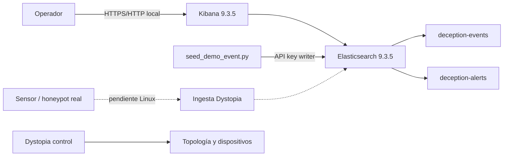
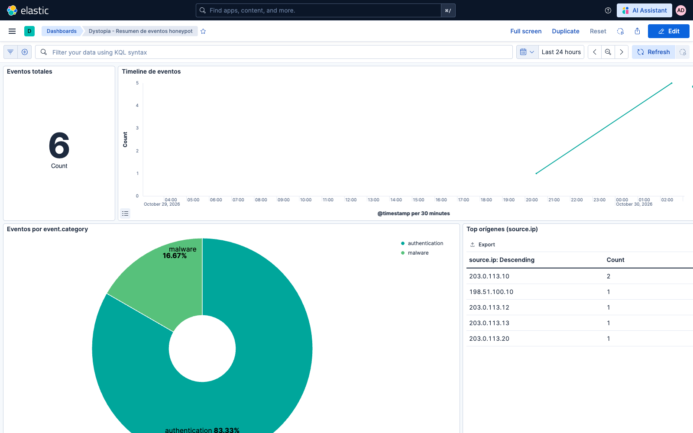
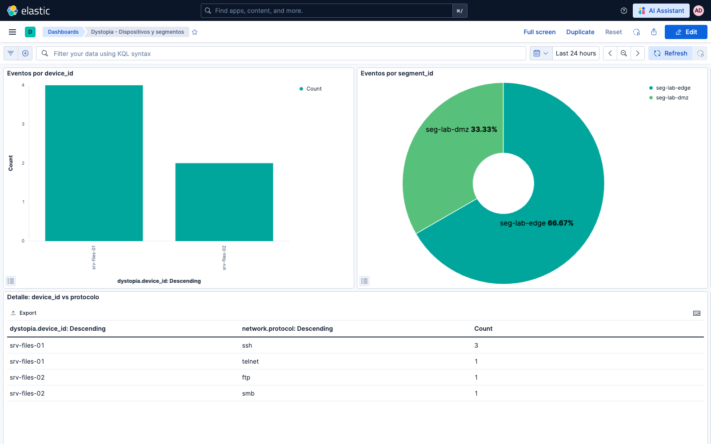
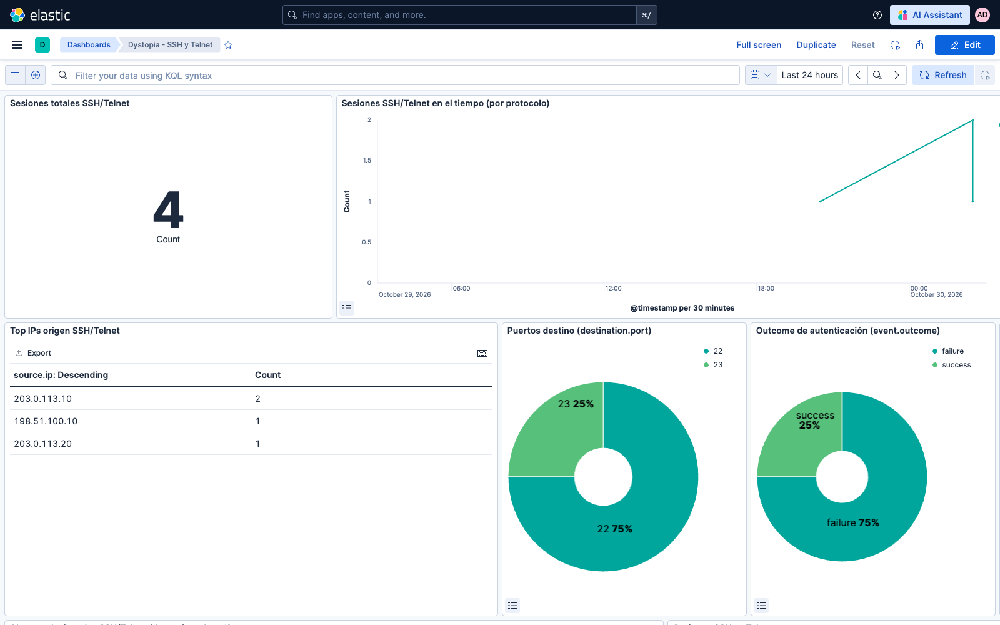
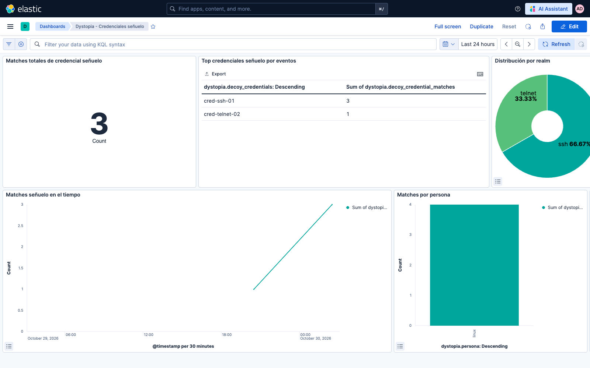
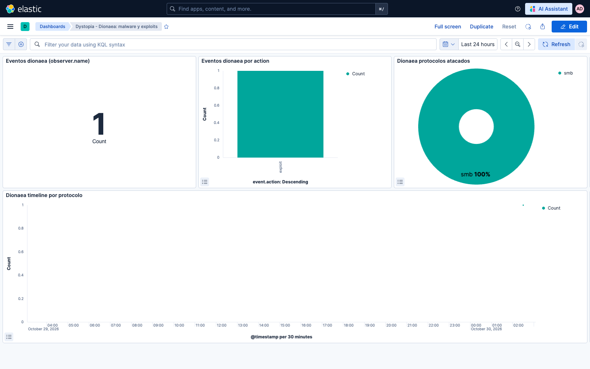
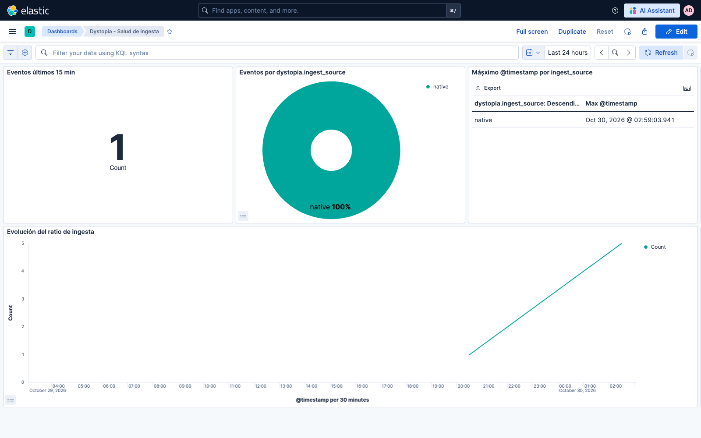
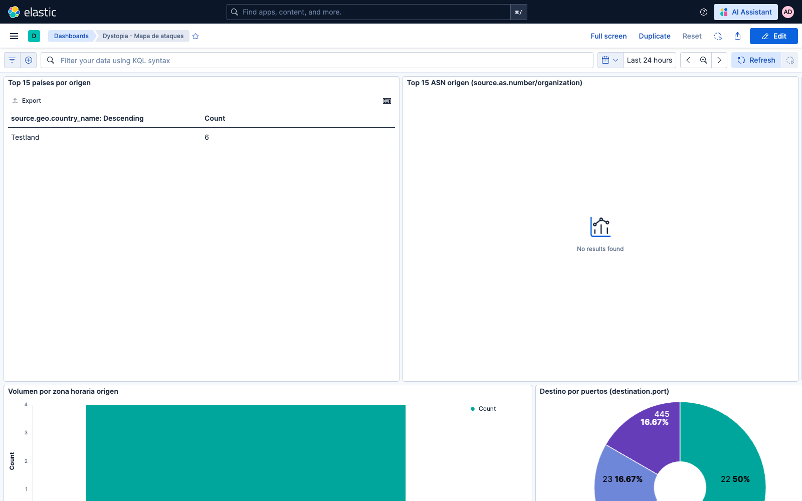
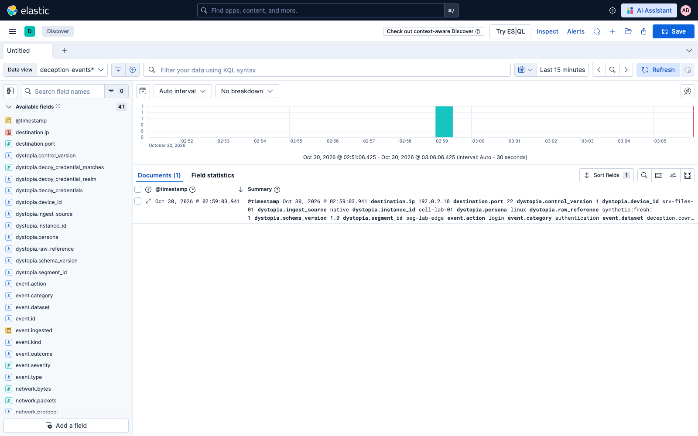

# Laboratorio local en macOS — qué se puede probar antes del servidor Linux

Esta guía permite levantar el plano analítico de Dystopia en tu Mac, importar
los dashboards, enviar eventos sintéticos y verificar la integración sin tocar
KVM, nftables ni la red señuelo real.

> **Alcance:** laboratorio local. No certifica contención, segmentación,
> firewall, systemd ni honeypots reales. Eso se valida después en Ubuntu Server
> 24.04.

## Qué usa

| Componente | Uso local | Notas |
|---|---|---|
| Python 3.12+ | Control, tests y herramientas | CI usa 3.12; también se probó 3.14 |
| FastAPI/Uvicorn | API de control | Dependencias en `requirements.txt` |
| SQLite | Estado local de control | No es la base analítica |
| Docker/Colima | Elasticsearch y Kibana | Docker Desktop también sirve |
| Elasticsearch 9.3.5 | Data streams `deception-events` / `deception-alerts` | TLS y autenticación obligatorios |
| Kibana 9.3.5 | 7 dashboards y Discover | Solo bind a `127.0.0.1` |
| OpenSSL/curl | Certificados y comprobaciones | macOS los incluye |
| Honeypots | Opcional en local | Cowrie, OpenCanary, Dionaea, Heralding, RedisHoneyPot, Endlessh |

No necesitas KVM/libvirt ni nftables para ver los dashboards.

## Arquitectura local



La topología sigue en Dystopia. Kibana solo consulta el plano analítico.

## 1. Preparar el laboratorio

Elige un directorio **fuera del repositorio** para secretos, certificados y
datos:

```bash
export LAB="$HOME/dystopia-lab"
mkdir -p "$LAB"/{data/elastic,data/kibana,certs,api-keys}
cp deploy/elastic/.env.example "$LAB/.env"
chmod 600 "$LAB/.env"
```

Edita `$LAB/.env` y cambia, como mínimo:

```dotenv
ELASTIC_DATA_DIR=/Users/TU_USUARIO/dystopia-lab/data/elastic
KIBANA_DATA_DIR=/Users/TU_USUARIO/dystopia-lab/data/kibana
ELASTIC_CERTS_DIR=/Users/TU_USUARIO/dystopia-lab/certs
ELASTIC_API_KEY_DIR=/Users/TU_USUARIO/dystopia-lab/api-keys
DYSTOPIA_ELASTIC_API_KEY_FILE=/Users/TU_USUARIO/dystopia-lab/api-keys/dystopia-ingest-writer.api-key
```

Rellena también todas las contraseñas `CHANGEME_*` y
`ELASTIC_CA_PASSPHRASE` con valores únicos. No reutilices contraseñas y no
commitees `$LAB/.env`.

Genera los certificados:

```bash
export ENV_FILE="$LAB/.env"
export ELASTIC_CERTS_DIR="$LAB/certs"
./deploy/elastic/scripts/generate-certs.sh
```

En macOS/Colima normalmente no hace falta cambiar el propietario de los
certificados. En Linux se ajusta al UID del contenedor:

```bash
sudo chown -R 1000:1000 "$LAB/certs" "$LAB/data"
```

Si Elasticsearch no arranca por `vm.max_map_count`, en Linux:

```bash
sudo sysctl -w vm.max_map_count=262144
```

## 2. Arrancar Elasticsearch y Kibana

```bash
docker compose \
  --env-file "$LAB/.env" \
  -f deploy/elastic/docker-compose.elastic.yml \
  --profile deception-elastic up -d
```

Comprueba el estado:

```bash
docker compose --env-file "$LAB/.env" \
  -f deploy/elastic/docker-compose.elastic.yml ps

curl -sS -o /dev/null -w '%{http_code}\n' http://127.0.0.1:5601/api/status
```

El puerto puede ser distinto si cambiaste `KIBANA_HTTP_PORT`; en el laboratorio
de referencia se usó `15601`.

## 3. Crear roles, usuarios, data streams y API key

```bash
ENV_FILE="$LAB/.env" \
ELASTIC_CERTS_DIR="$LAB/certs" \
./deploy/elastic/scripts/bootstrap-security.sh --all
```

Esto es idempotente:

- crea/actualiza roles;
- crea usuarios funcionales;
- instala ILM y plantillas;
- crea los data streams canónicos;
- rota la API key del writer y la deja con permisos `0600`.

La contraseña de `deception_admin` está en `$LAB/.env`; no se imprime en esta
guía.

## 4. Importar los dashboards

```bash
KIBANA="http://127.0.0.1:5601"
set -a; . "$LAB/.env"; set +a

curl -sS -u "deception_admin:$DECEPTION_ADMIN_PASSWORD" \
  -H 'kbn-xsrf: true' \
  -F 'file=@deploy/kibana-dashboards/artifacts/deception-kibana-bundle.ndjson' \
  "$KIBANA/api/saved_objects/_import?overwrite=true"
```

Debe devolver `success: true` y `53` objetos. **No uses
`createNewCopies=true`**: regenera IDs y rompe `defaultIndex`.

## 5. Abrir la vista

Abre:

```text
http://127.0.0.1:5601/app/dashboards#/view/deception-overview
```

Usuario: `deception_admin`
Contraseña: `$LAB/.env` → `DECEPTION_ADMIN_PASSWORD`.

Si no ves datos, cambia el rango temporal a **Last 24 hours**.

Dashboards disponibles:

| ID | Contenido |
|---|---|
| `deception-overview` | Resumen, timeline, top IPs, protocolos y países |
| `deception-geo-map` | Países, ASN, zonas horarias y puertos |
| `deception-devices-segments` | Dispositivos, segmentos y personas |
| `deception-ssh-telnet` | SSH/Telnet, sesiones y credenciales señuelo |
| `deception-decoy-credentials` | Identificadores señuelo, realms y matches |
| `deception-dionaea-malware` | Acciones, protocolos y explotación |
| `deception-ingest-health` | Últimos 15 min, procedencia y lag |

## 6. Enviar un evento sintético

El script usa la API key del writer, no contraseñas de usuario:

```bash
python3 scripts/seed_demo_event.py \
  --url "https://127.0.0.1:9200" \
  --api-key-file "$LAB/api-keys/dystopia-ingest-writer.api-key" \
  --ca-cert "$LAB/certs/ca.crt"
```

Debe imprimir `created ... (HTTP 201)`. Después abre Discover y selecciona el
data view `deception-events*`.

Para ver el documento sin enviarlo:

```bash
python3 scripts/seed_demo_event.py --dry-run
```

## 7. Verificar sin abrir el navegador

```bash
.venv/bin/ruff check app tests
.venv/bin/python -m pytest -q
.venv/bin/python -m pytest -q tests/integration_unified tests/ui
```

Regenerar el bundle y comprobar que no cambia el hash:

```bash
python3 deploy/kibana-dashboards/tools/build_dashboards.py \
  --out /tmp/dystopia-bundle-check.ndjson
```

El hash esperado del bundle canónico es:

```text
47477017d8737bd61c782c7611eee0855026d395ed1edde09c5dc45e70e586aa
```

## 8. Parar el laboratorio

```bash
docker compose \
  --env-file "$LAB/.env" \
  -f deploy/elastic/docker-compose.elastic.yml \
  --profile deception-elastic down
```

Los datos y certificados siguen en `$LAB`. Para borrarlos, hazlo de forma
explícita y consciente:

```bash
rm -rf "$LAB/data" "$LAB/certs" "$LAB/api-keys"
```

## Galería

### Resumen



### Dispositivos y segmentos



### SSH y Telnet



### Credenciales señuelo



### Dionaea: malware y exploits



### Salud de ingesta



### Mapa



### Discover



## Qué no se puede cerrar en macOS

- KVM/libvirt y arranque real de celdas.
- nftables, routing, NAT y aislamiento por segmento.
- systemd, usuarios de servicio y permisos definitivos.
- Honeypots reales con tráfico de red.
- TLS de Kibana tras reverse proxy y exposición de gestión.
- Snapshots/restore y operación de producción.

Cuando llegue el servidor Linux, el siguiente paso es
[`docs/HARDENING-OPERATIONS.md`](HARDENING-OPERATIONS.md) y el
[`docs/ROADMAP.md`](ROADMAP.md).
