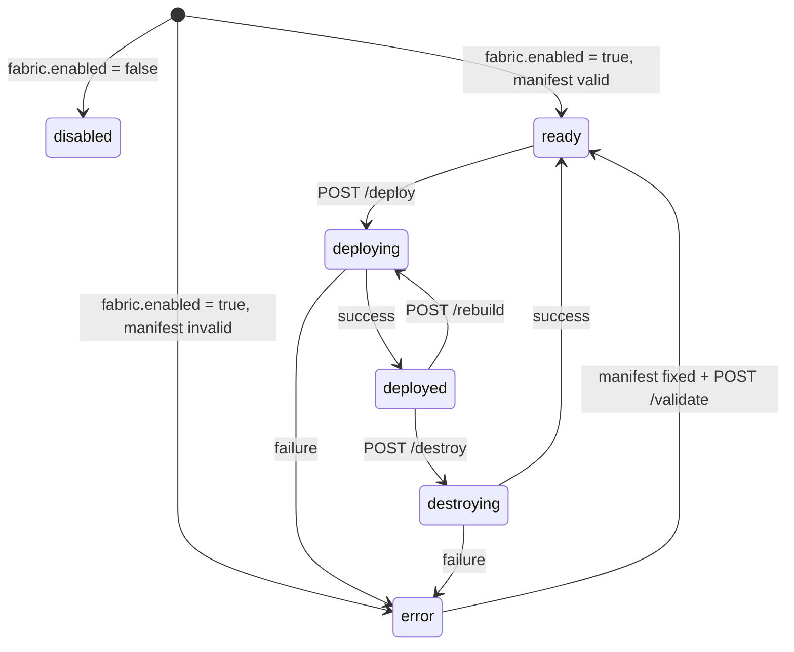
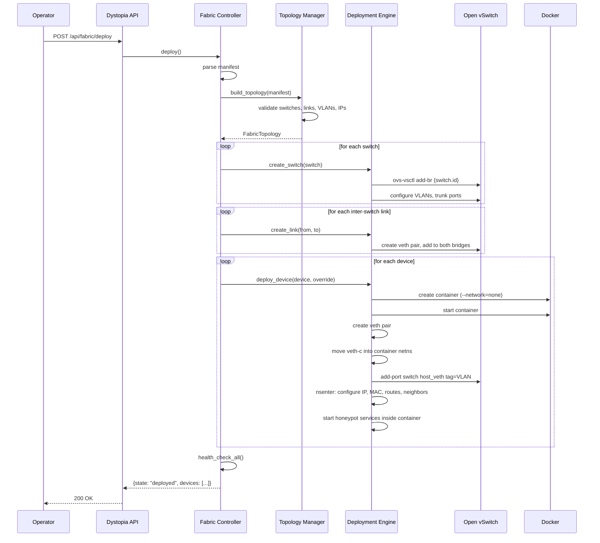
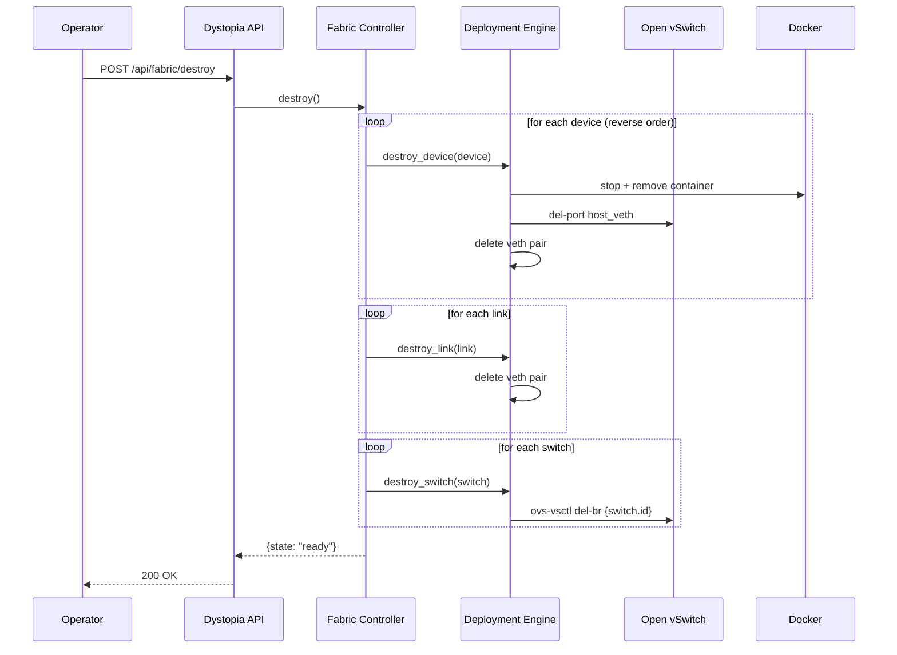

# Dystopia Network Fabric — Specification

> **Version:** 1.0 · **Date:** 2026-11-15 · **Status:** Draft for review
>
> **For agentic workers:** REQUIRED SUB-SKILL: Use
> superpowers:subagent-driven-development (recommended) or
> superpowers:executing-plans to implement this spec task-by-task.

---

## 1. Vision

Dystopia evolves from a honeypot management platform into an **open-source
distributed infrastructure emulation and deception platform**. The Network
Fabric is a new module that lets operators define an entire decoy network in a
single YAML manifest and have Dystopia instantiate it — virtual switches, VLAN
segments, device containers, honeypot bindings, credentials, routes, and
telemetry — automatically.

### 1.1 Goals

| # | Goal |
|---|------|
| G1 | Define a complete decoy network in a backward-compatible extension of the existing `network.yaml`. |
| G2 | Instantiate the virtual topology with Mininet + Open vSwitch on the same Ubuntu 24.04 host. |
| G3 | Deploy device containers (Docker) connected to OVS switches via veth pairs. |
| G4 | Bind existing honeypots (Cowrie, OpenCanary, Dionaea, Heralding, RedisHoneyPot, Endlessh) to device services. |
| G5 | Collect telemetry from the fabric into the existing Dystopia event pipeline. |
| G6 | Expose the fabric lifecycle through the existing Dystopia REST API. |
| G7 | Visualize the fabric topology in the existing Dystopia Web dashboard. |
| G8 | Preserve 100 % backward compatibility: when `fabric.enabled` is absent or `false`, Dystopia behaves exactly as today. |

### 1.2 Non-Goals (MVP)

- FRRouting / dynamic routing (Phase 2).
- Conpot / industrial protocol emulation (Phase 2).
- Multi-host distributed fabric (Phase 2).
- WAN link emulation (latency, jitter, loss).
- GUI-based topology editor (Phase 2; CLI + YAML first).

---

## 2. Architecture

```
┌──────────────────────────────────────────────────────────────────┐
│                      DYSTOPIA PLATFORM                          │
│                                                                  │
│  ┌─────────────┐  ┌──────────────┐  ┌──────────────────────┐   │
│  │ Dystopia API │  │ Dystopia Web │  │ Event Pipeline       │   │
│  │ (FastAPI)    │◄─┤ (React)      │  │ (store/alert/loki)   │   │
│  └──────┬───────┘  └──────────────┘  └──────────▲───────────┘   │
│         │                                        │               │
│  ┌──────▼────────────────────────────────────────┤──────────┐   │
│  │              NETWORK FABRIC MODULE                       │   │
│  │                                                          │   │
│  │  ┌────────────────┐  ┌─────────────────┐                │   │
│  │  │ Manifest Parser │  │ Fabric Controller│                │   │
│  │  │ (schema v1.1)   │──►  ┌────────────┐ │                │   │
│  │  └────────────────┘  │  │ Topology    │ │                │   │
│  │                       │  │ Manager     │ │                │   │
│  │                       │  ├────────────┤ │                │   │
│  │                       │  │ Deployment  │ │                │   │
│  │                       │  │ Engine      │ │                │   │
│  │                       │  ├────────────┤ │                │   │
│  │                       │  │ Lifecycle   │ │                │   │
│  │                       │  │ Manager     │ │                │   │
│  │                       │  └────────────┘ │                │   │
│  │                       └────────┬────────┘                │   │
│  └────────────────────────────────┼─────────────────────────┘   │
│                                   │                              │
│         ┌─────────────────────────┼───────────────────┐         │
│         │           RUNTIME LAYER (Linux)             │         │
│         │                                             │         │
│         │   ┌──────────┐   ┌───────────┐              │         │
│         │   │ Mininet  │   │ Docker    │              │         │
│         │   │ API      │   │ SDK      │              │         │
│         │   └─────┬────┘   └─────┬────┘              │         │
│         │         │              │                     │         │
│         │   ┌─────▼────┐   ┌────▼─────┐              │         │
│         │   │ OVS      │   │ Device   │              │         │
│         │   │ Switches │◄──┤ Containers│              │         │
│         │   │ (VLANs)  │   │ + Honeypots│             │         │
│         │   └──────────┘   └──────────┘              │         │
│         └─────────────────────────────────────────────┘         │
└──────────────────────────────────────────────────────────────────┘
```

### 2.1 Component Responsibilities

| Component | Responsibility |
|-----------|---------------|
| **Manifest Parser** | Validates the extended `network.yaml`, merges the `fabric:` block with existing `segments`/`devices`, and produces an immutable `FabricTopology` object. |
| **Topology Manager** | Translates a `FabricTopology` into Mininet/OVS primitives: switches, hosts, links, VLANs, IP/MAC assignments. Pure data transform — no side effects. |
| **Deployment Engine** | Executes the topology: creates OVS bridges, network namespaces, veth pairs, Docker containers; attaches container interfaces to OVS ports with the correct VLAN tags. |
| **Lifecycle Manager** | Manages bring-up, teardown, health checks, and rebuild of the fabric. Idempotent: re-deploy is clean destroy + create. |
| **Device Runtime** | Per-container agent that configures network interfaces, starts services, emits heartbeats and telemetry back to Dystopia. |
| **Fabric Controller** | Orchestrator that ties Parser → Topology → Deployment → Lifecycle and exposes operations to the API layer. |

### 2.2 Module Boundaries

The Fabric is an **independent module** inside Dystopia:

```
app/services/fabric/          ← Fabric Controller, Topology Manager
app/services/fabric/parser.py ← Manifest Parser
app/services/fabric/deploy.py ← Deployment Engine
app/services/fabric/lifecycle.py ← Lifecycle Manager
app/services/fabric/runtime.py  ← Device Runtime integration
app/services/fabric/models.py   ← Pydantic models for the fabric
app/routers/fabric.py           ← API endpoints
fabric/                          ← Runtime scripts (run inside containers)
```

It imports from `app.models.deception` and `app.services.deception.topology_svc`
(read-only) but never mutates the core deception models. The existing platform
continues to work unchanged when `fabric.enabled` is `false` or absent.

---

## 3. Schema: Extended `network.yaml`

### 3.1 Backward Compatibility Contract

The existing top-level keys (`segments`, `devices`) remain unchanged and
fully operational. A new optional top-level key `fabric` activates the
Network Fabric when present and `enabled: true`. Without this key, Dystopia
loads `segments` and `devices` exactly as today.

### 3.2 Full Schema

```yaml
# ── Existing keys (unchanged) ──────────────────────────────────
segments:
  - id: vlan-oficina
    vlan_id: 10
    cidr: 10.10.0.0/24
    gateway: 10.10.0.1
    isolated: true
    description: "Puestos de trabajo"

devices:
  - id: pc-recepcion-01
    role: pc
    segment: vlan-oficina
    ip: 10.10.0.21
    persona:
      vendor: dell
      os: windows
      hostname: RECEPCION-PC
      mac: "00:1c:42:10:10:21"
    services:
      - { port: 22, proto: ssh, engine: cowrie, instance: cowrie-oficina-01,
          banner: "OpenSSH_8.9" }
    tags: [office, windows]

# ── New: Fabric extension ──────────────────────────────────────
fabric:
  enabled: true
  name: "corporate-deception-net"

  # ── Global defaults ─────────────────────────────────────────
  defaults:
    device_image: "dystopia/fabric-device:v1"
    mem_limit: "128m"
    cpus: 0.25

  # ── Virtual Switches ────────────────────────────────────────
  switches:
    - id: sw-core
      type: ovs                        # always OVS in MVP
      stp: false                       # STP off by default for deception
      vlans: [10, 20, 30, 40]          # VLANs this switch trunks
      description: "Core aggregation switch"

    - id: sw-oficina
      type: ovs
      vlans: [10]
      uplink: sw-core                  # optional: auto-creates a trunk link

    - id: sw-servidores
      type: ovs
      vlans: [20]
      uplink: sw-core

    - id: sw-camaras
      type: ovs
      vlans: [30]
      uplink: sw-core

  # ── Links (explicit, beyond uplink auto-links) ──────────────
  links:
    - from: sw-core
      to: sw-oficina
      trunk: true
      bandwidth: null                  # reserved for Phase 2

  # ── Device extensions (by device id) ─────────────────────────
  # Adds fabric-specific properties to devices already declared
  # in the top-level `devices:` list. A device not listed here
  # gets default fabric treatment if its segment is fabric-enabled.
  device_overrides:
    - id: pc-recepcion-01
      interfaces:
        - name: eth0
          segment: vlan-oficina
          ip: 10.10.0.21/24
          mac: "00:1c:42:10:10:21"
          gateway: 10.10.0.1
          vlan_tag: 10
          switch: sw-oficina

      credentials:
        - username: admin
          password: admin123
          service: ssh
          purpose: "Credencial señuelo para fuerza bruta"
        - username: root
          password: toor
          service: ssh
          purpose: "Credencial de alto valor"

      neighbors:
        - ip: 10.10.0.1
          mac: "00:1c:42:10:10:01"
          hostname: "gateway"
        - ip: 10.10.0.22
          mac: "00:1c:42:10:10:22"
          hostname: "RRHH-PC"

      routes:
        - destination: 0.0.0.0/0
          gateway: 10.10.0.1
        - destination: 10.20.0.0/24
          gateway: 10.10.0.1

      admin_behavior:
        management_protocol: ssh
        management_port: 22
        login_banner: "RECEPCION-PC login:"
        motd: "Authorized users only. All activity is monitored."
        shell_prompt: "C:\\Users\\admin>"
        idle_timeout: 300

      logging:
        syslog_target: "10.20.0.10"
        log_level: info
        forward_to_dystopia: true

      resources:
        image: "dystopia/fabric-device:v1"
        mem_limit: "128m"
        cpus: 0.25

    - id: srv-files-01
      interfaces:
        - name: eth0
          segment: vlan-servidores
          ip: 10.20.0.10/24
          mac: "00:1c:42:20:10:10"
          gateway: 10.20.0.1
          vlan_tag: 20
          switch: sw-servidores
      credentials:
        - username: admin
          password: P@ssw0rd
          service: ssh
      neighbors:
        - ip: 10.20.0.1
          mac: "00:1c:42:20:00:01"
          hostname: "gateway"
      routes:
        - destination: 0.0.0.0/0
          gateway: 10.20.0.1
      admin_behavior:
        management_protocol: ssh
        management_port: 22
        login_banner: "Ubuntu 22.04.3 LTS"
        shell_prompt: "admin@files01:~$"
        idle_timeout: 600
      logging:
        forward_to_dystopia: true

    - id: cam-entrada-01
      interfaces:
        - name: eth0
          segment: vlan-camaras
          ip: 10.30.0.11/24
          mac: "00:12:5a:30:00:11"
          gateway: 10.30.0.1
          vlan_tag: 30
          switch: sw-camaras
      credentials:
        - username: admin
          password: "12345"
          service: http
          purpose: "Default camera credentials"
      admin_behavior:
        management_protocol: http
        management_port: 80
        login_banner: "Hikvision Digital Technology"
      logging:
        forward_to_dystopia: true
```

### 3.3 Schema Rules

| Rule | Description |
|------|-------------|
| `fabric` absent or `fabric.enabled: false` | Dystopia loads `segments`/`devices` as today. No fabric runtime is started. |
| `fabric.enabled: true` | Fabric Controller validates the entire manifest, builds the topology, and waits for explicit `POST /api/fabric/deploy`. |
| `device_overrides[].id` | Must match an existing `devices[].id` in the top-level list. |
| `device_overrides[].interfaces[].segment` | Must match an existing `segments[].id`. |
| `device_overrides[].interfaces[].switch` | Must match a `fabric.switches[].id`. |
| `switches[].uplink` | Must reference another `fabric.switches[].id`. Creates a trunk link automatically. |
| VLAN consistency | `interfaces[].vlan_tag` must be in the set of `vlans` declared on the referenced switch. |
| IP/CIDR consistency | `interfaces[].ip` must belong to the CIDR of the referenced `segment`. (Reuses existing `topology_svc._ip_in_segment`.) |
| Credentials | Never appear in API responses. Stored encrypted at rest. Used only by the Device Runtime to populate honeypot configurations. |

---

## 4. Docker ↔ OVS Integration: The Device Runtime

> **This is the critical integration point.** Mininet hosts are network
> namespaces. Docker containers are also network namespaces. We bridge
> them by attaching the container's network namespace to OVS ports.

### 4.1 How It Works

```
                   OVS Bridge (sw-oficina)
                   ┌────────────────────────────┐
                   │  port 1: trunk to sw-core  │
                   │  port 2: veth-pc-recepcion │ ◄── VLAN access 10
                   │  port 3: veth-srv-files    │ ◄── VLAN access 20
                   └────────────────────────────┘
                              │
              ┌───────────────┤
              │               │
     ┌────────▼──────┐  ┌────▼───────────┐
     │ Docker:       │  │ Docker:        │
     │ pc-recepcion  │  │ srv-files      │
     │               │  │                │
     │ eth0: 10.10.  │  │ eth0: 10.20.   │
     │   0.21/24     │  │   0.10/24      │
     │ mac: 00:1c:.. │  │ mac: 00:1c:..  │
     └───────────────┘  └────────────────┘
```

### 4.2 Attachment Sequence (per device)

```python
# Pseudocode — executed by the Deployment Engine

# 1. Create Docker container with --network=none
container = docker.create(
    image=device.resources.image,
    network_mode="none",
    name=f"dystopia-fabric-{device.id}",
    mem_limit=device.resources.mem_limit,
    cpu_quota=device.resources.cpus,
    labels={"dystopia.fabric": "true", "dystopia.device": device.id},
)
container.start()

# 2. Get the container's PID and network namespace
pid = container.attrs["State"]["Pid"]
netns = f"/proc/{pid}/ns/net"

# 3. Create a veth pair
host_veth = f"veth-{device.id[:11]}"  # max 15 chars for iface name
container_veth = "eth0"
ip_link_add(host_veth, type="veth", peer=f"{host_veth}-c")

# 4. Move one end into the container's netns
ip_link_set(f"{host_veth}-c", netns=pid)

# 5. Inside the container namespace:
#    - Rename to eth0
#    - Set MAC
#    - Set IP
#    - Add routes
nsenter(pid, [
    f"ip link set {host_veth}-c name eth0",
    f"ip link set eth0 address {iface.mac}",
    f"ip addr add {iface.ip} dev eth0",
    f"ip link set eth0 up",
    f"ip route add default via {iface.gateway}",
])

# 6. Attach host end to OVS with VLAN tag
ip_link_set(host_veth, up=True)
ovs_vsctl("add-port", switch_id, host_veth,
          f"tag={iface.vlan_tag}")

# 7. Add static ARP entries for declared neighbors
for neighbor in device.neighbors:
    nsenter(pid, [
        f"arp -s {neighbor.ip} {neighbor.mac}"
    ])
```

### 4.3 Lifecycle Operations

| Operation | What happens |
|-----------|-------------|
| **Deploy** | Parse manifest → create OVS bridges → create containers → attach veth → configure IPs/routes/neighbors → start honeypot services → report ready. |
| **Destroy** | Stop containers → remove veth pairs → delete OVS bridges → remove network namespaces → clean up Docker resources. |
| **Rebuild** | Destroy + Deploy (idempotent). |
| **Status** | Poll container health + OVS port state + ping reachability between declared neighbors. |

### 4.4 Mininet's Role

Mininet is used as a **library** (not as a CLI tool):

```python
from mininet.net import Mininet
from mininet.node import OVSSwitch, RemoteController
```

Specifically:
- `OVSSwitch` manages the OVS bridge lifecycle.
- Mininet's `link` primitives create the inter-switch trunk links.
- **Device containers are NOT Mininet hosts.** We use Docker containers
  with manual veth attachment to OVS ports. This avoids the limitations
  of Mininet's built-in Docker support and gives us full control over
  container lifecycle, resource limits, and honeypot integration.

For the MVP, Mininet runs **without an external SDN controller** (the built-in
`OVSBridge` controller is sufficient). Phase 2 may introduce OpenDaylight or
Faucet for advanced flow rules.

---

## 5. Pydantic Models

```python
# app/services/fabric/models.py

class FabricSwitch(BaseModel):
    id: str
    type: Literal["ovs"] = "ovs"
    stp: bool = False
    vlans: list[int] = Field(default_factory=list)
    uplink: Optional[str] = None
    description: str = ""

class FabricLink(BaseModel):
    from_: str = Field(alias="from")
    to: str
    trunk: bool = True
    bandwidth: Optional[int] = None  # Phase 2

class FabricInterface(BaseModel):
    name: str = "eth0"
    segment: str
    ip: str                          # CIDR notation: 10.10.0.21/24
    mac: str
    gateway: Optional[str] = None
    vlan_tag: Optional[int] = None
    switch: str

class FabricCredential(BaseModel):
    username: str
    password: str                    # Encrypted at rest
    service: str                     # ssh, http, telnet, etc.
    purpose: str = ""

class FabricNeighbor(BaseModel):
    ip: str
    mac: str
    hostname: str = ""

class FabricRoute(BaseModel):
    destination: str                 # CIDR: 0.0.0.0/0
    gateway: str

class FabricAdminBehavior(BaseModel):
    management_protocol: str = "ssh"
    management_port: int = 22
    login_banner: str = ""
    motd: str = ""
    shell_prompt: str = "$ "
    idle_timeout: int = 300          # seconds

class FabricLogging(BaseModel):
    syslog_target: Optional[str] = None
    log_level: str = "info"
    forward_to_dystopia: bool = True

class FabricDeviceResources(BaseModel):
    image: str = "dystopia/fabric-device:v1"
    mem_limit: str = "128m"
    cpus: float = 0.25

class FabricDeviceOverride(BaseModel):
    id: str                          # Must match a top-level device id
    interfaces: list[FabricInterface] = Field(default_factory=list)
    credentials: list[FabricCredential] = Field(default_factory=list)
    neighbors: list[FabricNeighbor] = Field(default_factory=list)
    routes: list[FabricRoute] = Field(default_factory=list)
    admin_behavior: Optional[FabricAdminBehavior] = None
    logging: Optional[FabricLogging] = None
    resources: Optional[FabricDeviceResources] = None

class FabricDefaults(BaseModel):
    device_image: str = "dystopia/fabric-device:v1"
    mem_limit: str = "128m"
    cpus: float = 0.25

class FabricConfig(BaseModel):
    """Root of the `fabric:` block in network.yaml."""
    enabled: bool = False
    name: str = "dystopia-fabric"
    defaults: FabricDefaults = Field(default_factory=FabricDefaults)
    switches: list[FabricSwitch] = Field(default_factory=list)
    links: list[FabricLink] = Field(default_factory=list)
    device_overrides: list[FabricDeviceOverride] = Field(default_factory=list)

class FabricTopology(BaseModel):
    """Immutable, validated representation of the full fabric."""
    config: FabricConfig
    segments: list[DeceptionSegment]
    devices: list[DeceptionDevice]
    # Computed at validation time:
    switch_port_map: dict[str, list[str]] = Field(default_factory=dict)
    device_switch_map: dict[str, str] = Field(default_factory=dict)
```

---

## 6. REST API

All fabric endpoints live under `/api/fabric` with the existing auth
middleware. They require `admin` role for mutations and `viewer` for reads.

| Method | Path | Auth | Description |
|--------|------|------|-------------|
| `GET` | `/api/fabric/status` | viewer | Fabric state: `disabled`, `ready`, `deploying`, `deployed`, `error`, `destroying`. |
| `GET` | `/api/fabric/topology` | viewer | Validated topology (switches, links, device assignments, VLANs). Credentials excluded. |
| `GET` | `/api/fabric/topology/graph` | viewer | D3/ECharts-compatible graph of the topology (nodes + edges). |
| `POST` | `/api/fabric/validate` | admin | Validate the current manifest without deploying. Returns errors/warnings. |
| `POST` | `/api/fabric/deploy` | admin | Build and start the fabric. Idempotent: destroys existing first. |
| `POST` | `/api/fabric/destroy` | admin | Tear down the fabric cleanly. |
| `POST` | `/api/fabric/rebuild` | admin | Alias: destroy + deploy. |
| `GET` | `/api/fabric/devices` | viewer | List fabric devices with runtime state (container status, IP reachability, ports open). |
| `GET` | `/api/fabric/devices/{id}` | viewer | Single device detail with container logs, connectivity, and service health. |
| `GET` | `/api/fabric/switches` | viewer | OVS switch state: ports, VLANs, traffic counters. |
| `GET` | `/api/fabric/switches/{id}` | viewer | Single switch detail. |
| `GET` | `/api/fabric/health` | viewer | Cross-check: all declared neighbors reachable, all services responding, all containers healthy. |

### 6.1 State Machine



---

## 7. Data Model (SQLite)

The fabric uses the **existing** `deception_events` table for telemetry.
It adds one new table for fabric state:

```sql
CREATE TABLE IF NOT EXISTS fabric_state (
    id          INTEGER PRIMARY KEY AUTOINCREMENT,
    timestamp   TEXT    NOT NULL DEFAULT (strftime('%Y-%m-%dT%H:%M:%fZ', 'now')),
    state       TEXT    NOT NULL,    -- disabled/ready/deploying/deployed/error/destroying
    manifest_hash TEXT  NOT NULL,    -- SHA-256 of the parsed manifest
    topology_json TEXT  NOT NULL,    -- serialized FabricTopology (no credentials)
    error       TEXT    DEFAULT NULL,
    deployed_at TEXT    DEFAULT NULL,
    destroyed_at TEXT   DEFAULT NULL
);

CREATE TABLE IF NOT EXISTS fabric_device_state (
    device_id      TEXT    PRIMARY KEY,
    container_id   TEXT,
    container_name TEXT,
    state          TEXT    NOT NULL,  -- pending/running/stopped/error
    ip             TEXT,
    mac            TEXT,
    switch_id      TEXT,
    vlan_tag       INTEGER,
    last_health    TEXT,              -- ISO-8601
    error          TEXT    DEFAULT NULL
);
```

Events from fabric devices flow through the **existing** `telemetry_svc.emit()`
pipeline. The `device_id` in the event matches the device's `id` from the
manifest, connecting fabric telemetry to the existing dashboard, alerts, AI
monitor, and RAG memory.

---

## 8. Deployment Flow

### 8.1 Deploy



### 8.2 Destroy



---

## 9. Security and Isolation

### 9.1 Fabric Isolation

| Control | Implementation |
|---------|---------------|
| **Network isolation** | All OVS bridges are `internal: true` (no external connectivity). Inter-VLAN communication only through declared routes. |
| **Container hardening** | Same policy as existing honeypot cells: `read_only: true`, `no-new-privileges`, `cap_drop: ALL`, `cap_add: [NET_ADMIN, NET_RAW]` (required for veth/arp). Non-root UID. |
| **Resource limits** | Per-device `mem_limit`, `cpus`, `pids_limit`. Global fabric limit as sum. |
| **Credential protection** | Credentials encrypted at rest (Fernet, key from `DYSTOPIA_FABRIC_KEY`). Never in API responses. Never in container environment variables — injected via mounted config files with mode 0400. |
| **Namespace isolation** | Each device container runs in its own network namespace. No `--network=host`, no Docker socket mount, no `--privileged`. |
| **Audit** | All fabric operations logged via existing `audit_svc`. Deploy/destroy/rebuild produce audit trail entries. |
| **Activation gate** | `POST /api/fabric/deploy` requires `DYSTOPIA_FABRIC_ENABLED=true` environment variable AND admin JWT. Double gate prevents accidental activation. |

### 9.2 Permissions Required

The Dystopia process needs:
- `CAP_NET_ADMIN` — to create OVS bridges, veth pairs, manage namespaces.
- Docker socket access — to create/start/stop containers.
- `nsenter` capability — to configure interfaces inside container namespaces.

These are the **same privileges** already required for the KVM/libvirt cell
model. The Fabric does not widen the host attack surface beyond what Dystopia
already requires in production.

---

## 10. Frontend Integration

### 10.1 New Dashboard Section: "Fabric"

The existing Dystopia Web gets a new navigation item **"Fabric"** (alongside
Honeypots, Devices, Events, etc.) with:

1. **Topology Graph** — Interactive network diagram (ECharts graph or
   react-force-graph) showing switches, devices, VLANs as colored groups,
   and link states. Click a node → device detail panel.

2. **Fabric Status** — State machine badge (deployed / ready / error), last
   deploy time, device count, switch count.

3. **Device Table** — Extends the existing Devices page with fabric-specific
   columns: container status, switch, VLAN, connectivity.

4. **Fabric Controls** — Deploy / Destroy / Rebuild buttons (admin only).
   Validate button shows a pre-deploy report.

### 10.2 API Consumption

The frontend consumes:
- `GET /api/fabric/status` for the status badge.
- `GET /api/fabric/topology/graph` for the interactive diagram.
- `GET /api/fabric/devices` for the device table.
- `POST /api/fabric/deploy|destroy|rebuild` for lifecycle actions.

---

## 11. Testing Strategy

### 11.1 Unit Tests (no Linux, no Docker)

| Area | What to test |
|------|-------------|
| **Manifest Parser** | Valid/invalid YAML, backward compatibility, schema validation, credential handling, cross-reference integrity. |
| **Topology Manager** | Correct graph construction, VLAN propagation, IP validation, switch-port assignment, link generation. |
| **Models** | Pydantic validation for all fabric models. |

### 11.2 Integration Tests (require Docker, may require Linux)

| Area | What to test |
|------|-------------|
| **Deployment Engine** | Create/destroy OVS bridges, veth pairs, container attachment. Requires `sudo` + OVS + Docker. |
| **End-to-End** | Deploy a 2-switch, 3-device topology → verify ping between same-VLAN devices → verify isolation between VLANs → verify honeypot responds → verify events reach Dystopia pipeline. |
| **Lifecycle** | Deploy → destroy → redeploy → verify clean state. |
| **API** | Full HTTP lifecycle through the FastAPI test client (with mocked deployment on macOS, real on Linux). |

### 11.3 Test Matrix

| Environment | Parser | Topology | Deploy | E2E |
|-------------|--------|----------|--------|-----|
| macOS (CI) | ✅ | ✅ | mock | mock |
| Ubuntu 24.04 (lab) | ✅ | ✅ | ✅ | ✅ |

---

## 12. Implementation Plan — Phases

### Phase 0: Audit and Foundation (Prerequisite)
- Audit existing `topology_svc.py`, `deception.py` models, and `engine_svc.py`.
- Confirm Mininet and OVS install on Ubuntu 24.04.
- Define the `app/services/fabric/` module structure.

### Phase 1: Schema and Parser
- Extend `DeceptionNetwork` model with optional `fabric: FabricConfig`.
- Write `FabricConfig`, `FabricSwitch`, `FabricLink`, `FabricDeviceOverride` and related Pydantic models.
- Write the manifest parser with full cross-reference validation.
- Ensure backward compatibility: existing `network.yaml` without `fabric:` loads unchanged.
- **Tests:** 30+ unit tests for schema validation, edge cases, backward compat.

### Phase 2: Fabric Controller and Topology Manager
- Build `FabricTopology` from parsed manifest.
- Generate OVS bridge specs, veth pair specs, port-VLAN assignments.
- Implement the controller state machine (disabled → ready → deploying → deployed → …).
- **Tests:** Topology generation, state transitions, idempotency.

### Phase 3: Mininet + OVS Integration
- Use Mininet as a library to create OVS bridges and inter-switch links.
- Implement `create_switch()`, `destroy_switch()`, `create_link()`, `destroy_link()`.
- VLAN configuration on OVS ports.
- **Tests:** Integration tests on Ubuntu with real OVS (mocked on macOS).

### Phase 4: Docker Device Runtime
- Create containers with `--network=none`.
- veth pair creation and namespace attachment.
- IP/MAC/route/neighbor configuration via `nsenter`.
- Container resource limits.
- Honeypot service startup inside containers.
- **Tests:** Full container lifecycle, network connectivity.

### Phase 5: Honeypot Binding
- Map `services[].engine` to actual honeypot processes inside device containers.
- Cowrie, OpenCanary, Dionaea: mount config, start process, verify port binding.
- Connect honeypot event output to Dystopia's telemetry pipeline.
- **Tests:** Honeypot responds to probe, event appears in SQLite.

### Phase 6: API and Dashboard
- Implement all `/api/fabric/*` endpoints.
- Add the Fabric page to Dystopia Web.
- Topology graph visualization.
- Lifecycle controls (deploy/destroy/rebuild).
- **Tests:** API integration tests, frontend manual verification.

### Phase 7: Telemetry and Events
- Ensure all fabric device events flow through `telemetry_svc.emit()`.
- Credential capture from honeypots → events with `detail.credentials`.
- Fabric-specific alerts (new device probed, lateral movement between VLANs).
- **Tests:** Event pipeline E2E, alert trigger verification.

### Phase 8: Security, Hardening, and Documentation
- Credential encryption at rest.
- Audit trail for all fabric operations.
- Double-gate activation (`DYSTOPIA_FABRIC_ENABLED` + admin JWT).
- Write `docs/FABRIC.md`, `docs/FABRIC-OPERATIONS.md`.
- Update `README.md` with fabric documentation links.
- **Tests:** Security invariant tests, credential leak scan.

---

## 13. Acceptance Criteria (MVP)

| # | Criterion | Verification |
|---|-----------|-------------|
| AC1 | A `network.yaml` with `fabric.enabled: true` defines a complete virtual network. | Parser validates and produces `FabricTopology`. |
| AC2 | At least 2 segments/VLANs are instantiated as OVS bridges. | `ovs-vsctl show` lists the bridges with correct VLAN config. |
| AC3 | Virtual hosts are Docker containers connected to OVS ports. | `docker ps` + `ovs-vsctl list-ports` confirm attachment. |
| AC4 | Each device has assigned IP, MAC, and routes. | `nsenter` into container → `ip addr`, `ip route`, `arp -a` show correct config. |
| AC5 | Devices on the same VLAN can communicate. | `ping` between same-VLAN devices succeeds. |
| AC6 | Devices on different VLANs are isolated. | `ping` between different VLANs fails (unless routed). |
| AC7 | Honeypots respond on declared service ports. | `ssh`, `curl`, `nmap` to device IP:port gets expected banner. |
| AC8 | Events from honeypots appear in Dystopia. | Dashboard shows events with correct `device_id`, `src_ip`, `proto`. |
| AC9 | `POST /api/fabric/destroy` cleanly tears down everything. | No orphan containers, veths, or OVS bridges after destroy. |
| AC10 | `POST /api/fabric/rebuild` produces identical topology. | Manifest hash matches, all ACs re-verified. |
| AC11 | Without `fabric:` key, Dystopia works exactly as before. | Existing test suite passes unchanged. |
| AC12 | Topology visible in the dashboard. | Fabric page shows graph with switches, devices, VLANs, link states. |
| AC13 | Credentials are never exposed in API responses. | Security test: `GET /api/fabric/topology` contains no password fields. |

---

## 14. Dependencies

| Dependency | Version | Purpose | License |
|-----------|---------|---------|---------|
| Mininet | 2.3.1+ | Virtual network topology | BSD |
| Open vSwitch | 3.1+ | Virtual switching, VLANs | Apache 2.0 |
| Docker SDK for Python | 7.0+ | Container management | Apache 2.0 |
| Existing Dystopia deps | — | FastAPI, Pydantic, SQLite, etc. | MIT / various |
| `cryptography` (Fernet) | 41+ | Credential encryption | Apache 2.0 / BSD |

### System Requirements (Ubuntu 24.04)

```bash
# Mininet + OVS
sudo apt install mininet openvswitch-switch openvswitch-common

# Docker (already required by Dystopia)
# docker-ce from Docker's official repo

# Python bindings
pip install mininet docker cryptography
```

---

## 15. File Map

```
app/
  services/
    fabric/
      __init__.py              ← Module init, exports controller
      models.py                ← Pydantic models (§5)
      parser.py                ← Manifest parser, schema validation
      topology.py              ← Topology Manager: manifest → graph
      controller.py            ← Fabric Controller: orchestrator + state machine
      deploy.py                ← Deployment Engine: OVS + Docker operations
      lifecycle.py             ← Lifecycle Manager: deploy/destroy/rebuild/health
      runtime.py               ← Device Runtime: per-container config + telemetry
      credential_store.py      ← Fernet encrypt/decrypt for credentials
  routers/
    fabric.py                  ← REST API endpoints (§6)
  models/
    deception.py               ← MODIFIED: add optional FabricConfig to DeceptionNetwork

config/
  deception/
    network.yaml               ← MODIFIED: add fabric: block (optional)

web/
  src/
    pages/
      FabricPage.tsx           ← New: topology graph + controls

fabric/
  device-entry.sh              ← Container entrypoint script
  Dockerfile                   ← Base device image

tests/
  test_fabric_parser.py        ← Schema validation tests
  test_fabric_topology.py      ← Graph construction tests
  test_fabric_models.py        ← Pydantic validation tests
  test_fabric_controller.py    ← State machine tests
  test_fabric_api.py           ← API endpoint tests
  integration/
    test_fabric_deploy.py      ← OVS + Docker integration (Linux only)
    test_fabric_e2e.py         ← Full pipeline E2E (Linux only)

docs/
  FABRIC.md                    ← User-facing documentation
  FABRIC-OPERATIONS.md         ← Operations runbook
```

---

## 16. References

| Project | Role in Dystopia Fabric |
|---------|------------------------|
| [Honeyd](http://www.honeyd.org/) | Reference for host simulation patterns (IP stack personality, service templates). |
| [HoneyFactory](https://github.com/) | Reference for honeynet topology generation from templates. |
| [Mininet](http://mininet.org/) | Virtual network topology engine. |
| [Open vSwitch](https://www.openvswitch.org/) | Programmable virtual switch with VLAN, trunk, and flow support. |
| [FRRouting](https://frrouting.org/) | Dynamic routing (Phase 2). |
| [Conpot](https://conpot.org/) | ICS/SCADA honeypot (Phase 2). |
