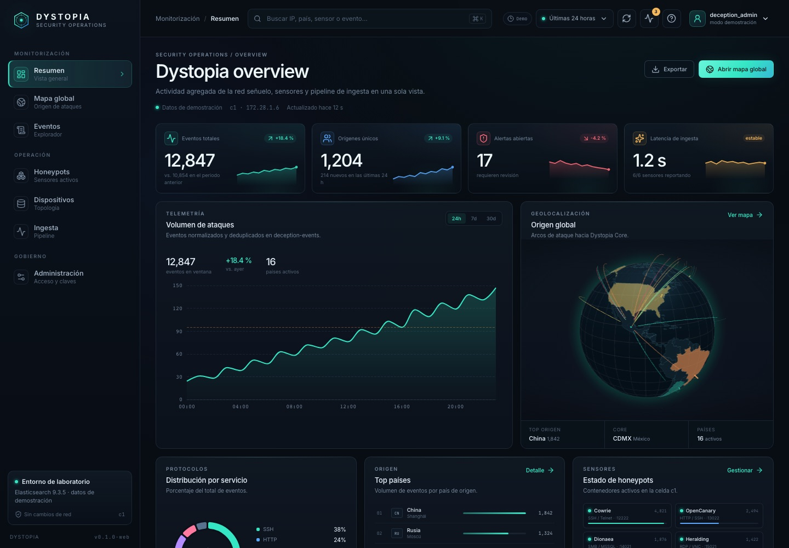
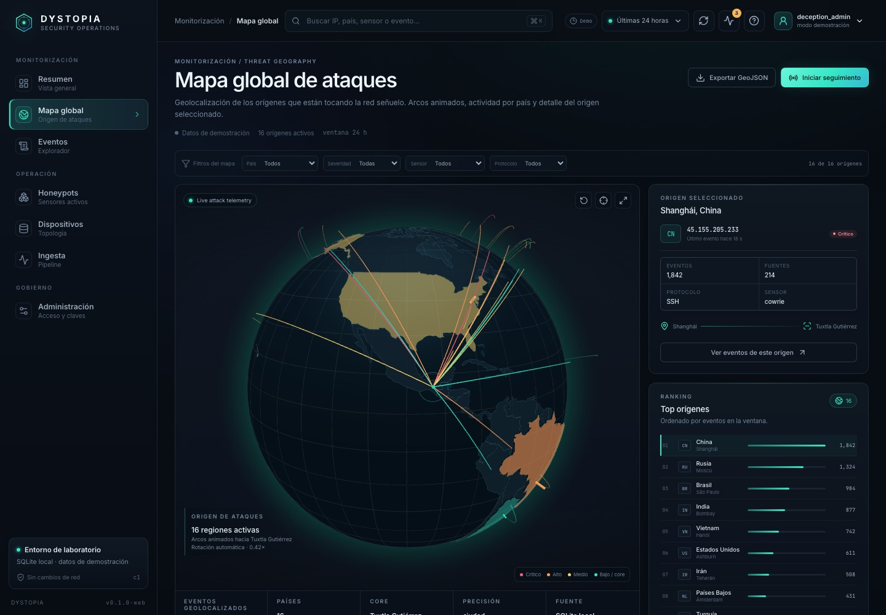

# Dystopia Web

Interfaz de operaciones de Dystopia. Está inspirada en los flujos de Kibana
(Dashboards, Discover, time picker y mapa), pero usa marca, navegación y
componentes propios. No copia código, assets ni marcas de Elastic.

## Estado

- Resumen operativo con métricas, timeline, protocolos, ranking y actividad.
- Mapa global 3D con globo terráqueo, arcos animados y selección de origen.
- Explorador de eventos tipo Discover con filtros, paginación, detalle y CSV.
- Estado de los seis honeypots del MVP.
- Topología declarativa de dispositivos y segmentos.
- Salud del pipeline de ingesta.
- Administración de usuarios, claves y configuración.

La analítica se obtiene del BFF `/api/analytics/*`, que lee el almacén SQLite
local de Dystopia. El navegador no recibe la ruta de la base ni credenciales.

## Stack

- React 19 + TypeScript + Vite
- Apache ECharts para series y distribuciones
- `react-globe.gl` / Three.js para el globo 3D
- Lucide para iconografía
- CSS propio con tokens de diseño

## Desarrollo

```bash
cd web
npm install
npm run dev
```

Abre `http://127.0.0.1:5173`. El proxy de Vite envía `/api` a
`http://127.0.0.1:8082`.

## Build

```bash
cd web
npm run build
```

El build queda en `web/dist` con base `/static/web/` para servirlo desde
FastAPI.

## Pruebas end-to-end (sin backend real)

Desde la raíz del repositorio:

```bash
npm ci
npm --prefix web ci
npx playwright install chromium
npx playwright test
```

Playwright inicia Vite en `127.0.0.1:5179` e intercepta **todas** las peticiones
`/api/**` con datos sintéticos; ninguna prueba usa eventos ni credenciales del
servidor. Los resultados y trazas locales quedan fuera de Git.

## Contrato de datos

La UI consume el BFF de Dystopia, nunca SQLite directamente:

```text
GET /api/analytics/overview?from=...&to=...
GET /api/analytics/timeline?from=...&to=...&interval=...
GET /api/analytics/origins?from=...&to=...
GET /api/analytics/events?from=...&to=...&page=...
GET /api/analytics/health
```

Configuración del control plane:

```bash
DYSTOPIA_ANALYTICS_DB=/ruta/privada/deception.db
DYSTOPIA_ANALYTICS_MAX_ROWS=20000
```

El BFF detecta el esquema local:

- `deception_events`: control plane / simulador.
- `events`: runtime v1 escrito por la ingesta independiente.

## Capturas




